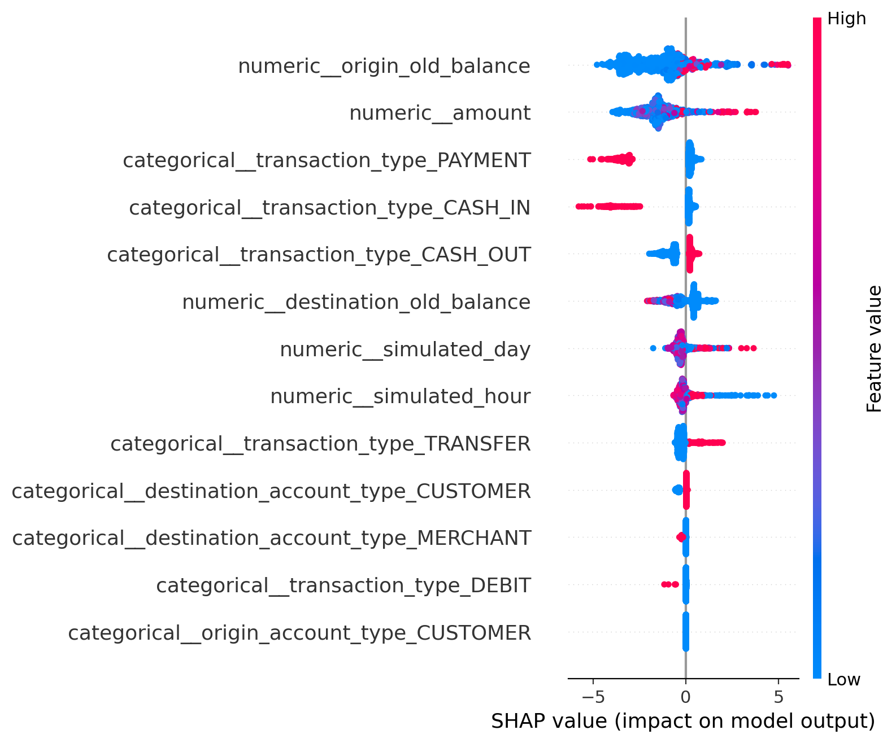
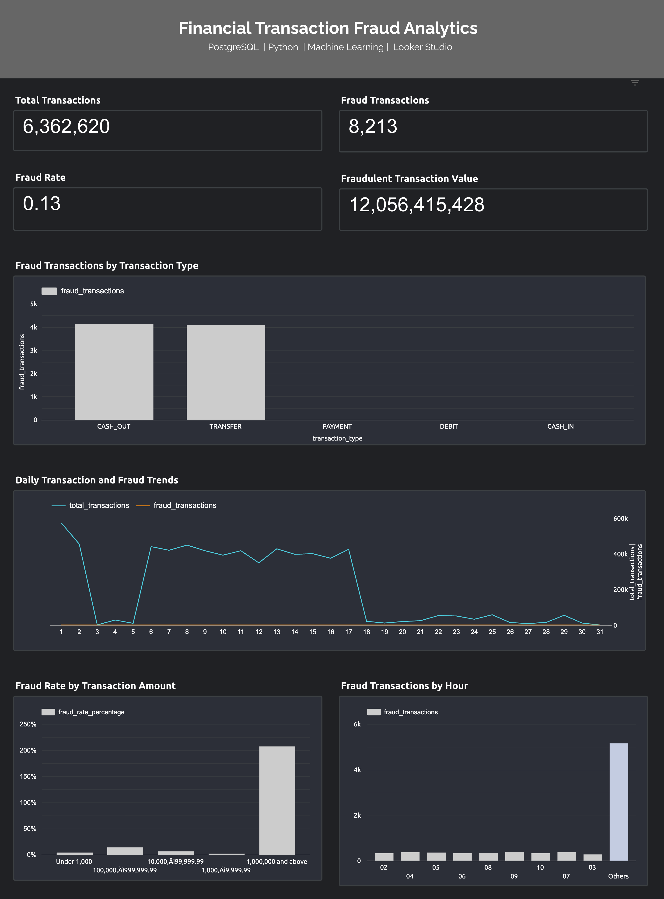

# Financial Transaction Analytics & Fraud Detection

An end-to-end financial transaction analytics and fraud detection project using **PostgreSQL, Python, machine learning, SHAP explainability, and Google Looker Studio**. The project transforms a large synthetic financial transaction dataset into validated analytical tables, interactive dashboard insights, and machine learning models designed to identify potentially fraudulent transactions.

## Project Objectives

- Build a structured PostgreSQL data pipeline for large-scale transaction data.
- Profile, clean, validate, and transform transaction records.
- Develop analytical views to investigate fraud patterns across transaction types, time, and transaction amounts.
- Compare machine learning models using evaluation metrics suitable for imbalanced classification.
- Apply SHAP to explain the factors influencing model predictions.
- Present key fraud indicators through an interactive Looker Studio dashboard.

## Technology Stack

| Area | Tools |
|---|---|
| Database | PostgreSQL |
| Data processing | Python, pandas, NumPy |
| Machine learning | scikit-learn, XGBoost |
| Model explainability | SHAP |
| Visualisation | Matplotlib, Seaborn |
| Dashboard | Google Looker Studio, Google Sheets |
| Version control | Git, GitHub |

## Data Pipeline

The project follows a layered analytics architecture:

`Raw Data → Staging → Data Warehouse → Analytics Views → Machine Learning & Dashboard`

- **Raw:** Stores the source transaction records.
- **Staging:** Applies data validation and transformation checks.
- **Data warehouse:** Organises transactions using fact and dimension tables.
- **Analytics:** Provides SQL views for fraud KPIs and transaction-pattern analysis.
- **Machine learning:** Trains and evaluates fraud classification models.
- **Dashboard:** Presents business-focused fraud indicators and trends.

## Dataset

The project uses the PaySim synthetic financial transaction dataset.

- Total transactions: **6,362,620**
- Fraudulent transactions: **8,213**
- Non-fraudulent transactions: **6,354,407**
- Fraud prevalence: approximately **0.1291%**

The dataset is highly imbalanced, making accuracy alone unsuitable for evaluating fraud detection performance. As the data is synthetic, its patterns and model results should not be assumed to represent real financial institutions.

## SQL Analytics

PostgreSQL is used to profile the source data, validate transformations, build warehouse tables, and create analytical views.

The analysis covers:

- Overall transaction and fraud KPIs.
- Fraud rates by transaction type.
- Daily and hourly transaction patterns.
- Fraud rates across transaction amount bands.
- Transaction values and fraudulent transaction values.
- Validation of record counts, unique transaction identifiers, and warehouse relationships.

## Machine Learning

Four classification algorithms are compared:

1. Logistic Regression
2. Decision Tree
3. Random Forest
4. XGBoost

The modelling workflow includes preprocessing, class-imbalance handling, validation-based threshold selection, and evaluation on a held-out test set.

Evaluation metrics include:

- Precision
- Recall
- F1-score
- ROC-AUC
- Average Precision (PR-AUC-related measure)
- True positives, false positives, and false negatives

Threshold selection is performed using the validation set rather than the final test set. The modelling dataset excludes existing fraud-flag information and post-transaction balance features to reduce leakage risks.

### Model Comparison

XGBoost was the strongest candidate in the current test-set comparison, achieving:

| Metric | Result |
|---|---:|
| ROC-AUC | 0.9992 |
| Average Precision | 0.8912 |
| Precision | 0.2373 |
| Recall | 0.9515 |
| F1-score | 0.3799 |
| False positives | 4,981 |
| Fraud cases detected | 1,550 |

These results are specific to the synthetic PaySim dataset and the current sampling and evaluation design. They require further robustness testing before any real-world deployment conclusions can be drawn.

## Model Explainability

SHAP is used to investigate which features contribute to XGBoost predictions. The analysis includes a feature-importance summary and a visualisation of feature contributions.

The current sample-based analysis highlights origin balance, transaction amount, and transaction type among the most influential features. SHAP results describe model behaviour; they do not establish causal relationships.

### SHAP Summary Plot



This visualisation summarises how the input features influence the XGBoost model's predictions across the sampled observations. Feature contributions indicate model behaviour, not causation.


## Interactive Dashboard

The Google Looker Studio dashboard presents:

- Total transactions
- Fraudulent transactions
- Fraud rate
- Fraudulent transaction value
- Fraud counts by transaction type
- Daily transaction and fraud trends
- Fraud counts by hour
- Fraud rate by transaction amount band

The dashboard uses analytical exports generated from PostgreSQL views.

### Dashboard Preview



## Repository Structure

```text
financial-transaction-fraud-analytics/
├── data/
│   ├── raw/
│   └── processed/
├── do
|-looker_studio/
├── models/
├── notebooks/
├── sql/
├── src/
├── requirements.txt
├── .gitignore
└── README.md
```

Large source and processed CSV files are excluded from version control. The repository contains the project code, SQL scripts, documentation, and selected model artifacts.

## Reproducibility

1. Install PostgreSQL and Python.
2. Create the project database and schemas using the SQL scripts.
3. Download the PaySim dataset from its original source and place it in the expected local data directory.
4. Install the Python dependencies listed in `requirements.txt`.
5. Run the SQL pipeline and Python scripts in the documented order.
6. Export the analytical views and connect the resulting data to Looker Studio.

Database credentials and local environment settings should be configured separately and must not be committed to GitHub.

## Limitations and Future Improvements

- Validate performance on additional datasets or more realistic transaction scenarios.
- Investigate time-based validation to assess performance under temporal distribution changes.
- Examine threshold selection in relation to operational fraud-review capacity.
- Monitor precision and recall under the natural class distribution.
- Improve reproducibility documentation and dashboard deployment instructions.

## Disclaimer

This project is for educational, analytical, and portfolio purposes. It uses synthetic data and is not a production fraud detection system.

